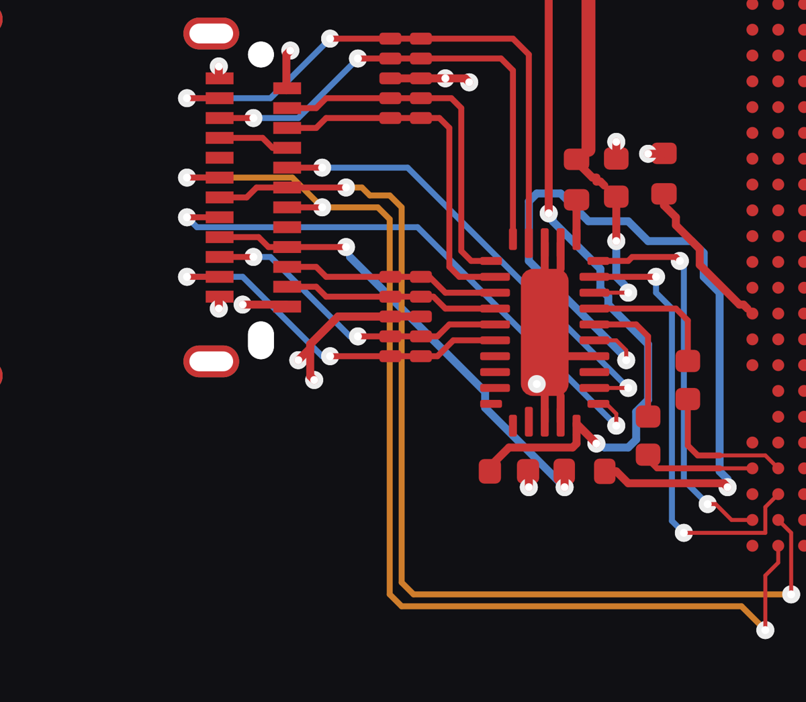
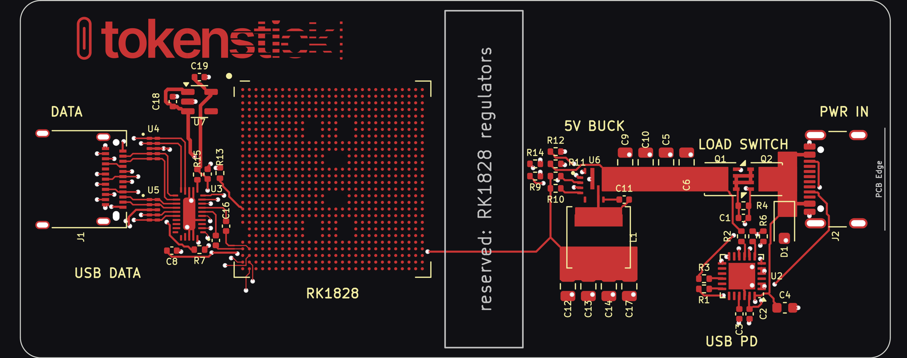
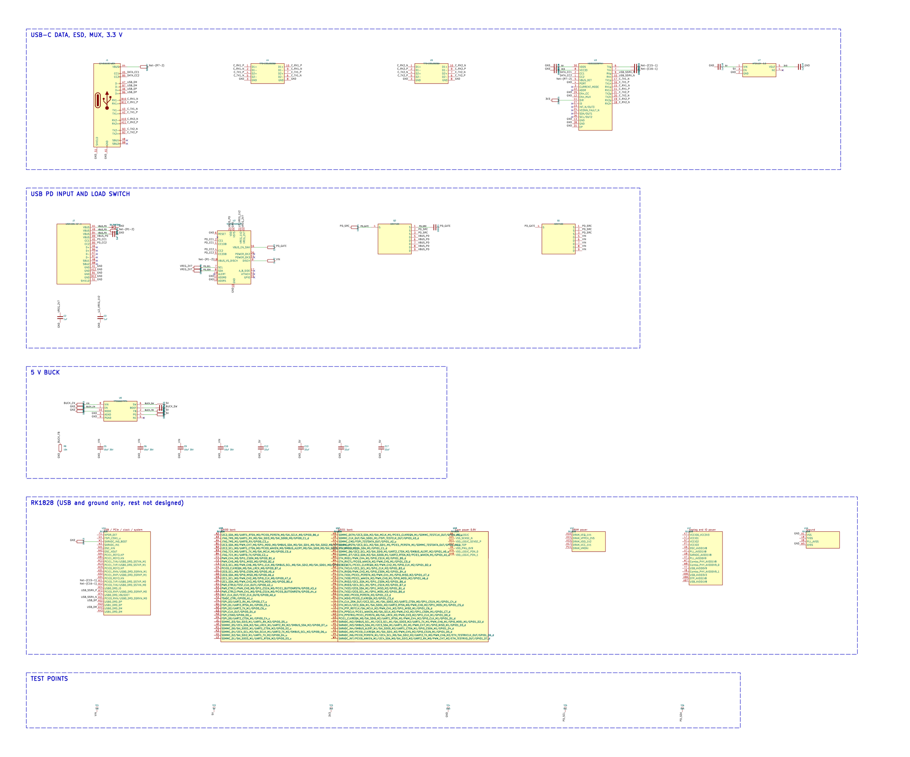
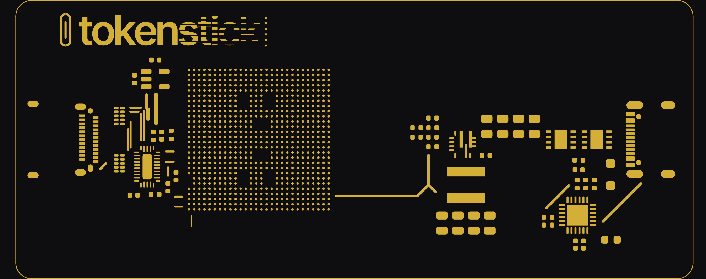

# TokenStick v1 design notes

Draft, 2026-11-14. Nothing in this document has been validated on hardware.

## 1. Product

- External USB-C accelerator for local LLM and VLM inference, home and office use
- USB stick form factor
- Out of scope for v1: M.2 variant, camera or sensor inputs, secure element, rugged design

## 2. Chip selection

| Candidate | Outcome | Reason |
|---|---|---|
| Hailo-10H | Dropped | Was the first choice (native USB, 2.5 W). Dropped by project decision |
| DEEPX DX-M1 | Not suitable | PCIe only; a USB-only design cannot use it |
| Rockchip RK1828 | Selected | Native USB 3.0, in-package DRAM, LLM-oriented |

RK1820 (2.5 GB DRAM) uses the same package and is a possible lower-cost variant. RK1860 is the announced successor; availability is not confirmed.

## 3. RK1828 facts from the datasheet (Rev 1.4)

- Package: FCBGA-746, 19 x 19 mm, 28 x 28 grid, 0.65 mm pitch, 0.36 mm ball
- Ball groups: 343 VSS, 171 VDD_LOGIC, 15 VDD_TOP, 84 DRAM supply, 22 AVSS, about 110 signal and analog
- All signal balls sit in columns 1-8 on one side of the package; the rest is power and ground
- Supplies: 0.9 V core (VDD_LOGIC, VDD_TOP, VDD_PMU), DRAM rails at 1.4 V, 1.1 V, 2.5 V and 1.2 V, 0.9 V and 1.8 V analog, 3.3 V USB, VCCIO at 1.8 V or 3.3 V
- USB: one USB 3.0 controller, assignable to either of two combo PHYs shared with PCIe 2.1; one separate USB 2.0 port. 5 Gbps only
- Boot ROM: boots from SPI flash, eMMC or SD; code download over USB 2.0, UART or PCIe. Boot source strap on SARADC_IN0_BOOT
- Clock: 24 MHz
- Thermal: Tj max 125 C; theta-JC 0.06 C/W (simulated)
- Not in the datasheet: supply currents, power sequencing, min/max for the 0.9 V core rails, pin function and reset-state table

## 4. Blocks drawn so far

### USB-C DATA
- 24-pin USB-C receptacle, two TPD4E05U06 ESD arrays on the SuperSpeed pairs
- HD3SS3220 as UFP: handles CC and selects the SuperSpeed lane for cable orientation. Needs 5 V and 3.3 V
- Why a mux: the receptacle has two SuperSpeed lane sets and the RK1828 has one USB 3.0 controller
- Nets to the chip: USB_SSTX_P/N, USB_SSRX_P/N, USB_DP, USB_DM, VBUS_DATA

### PD POWER INPUT
- 16-pin USB-C receptacle (power only), STUSB4500 standalone PD sink, two AON7403 P-channel FETs (30 V) back to back as the VBUS switch, 24 V TVS
- Output net VIN, 9-20 V after negotiation
- The STUSB4500 NVM must be programmed with the wanted profiles. I2C is pulled up but no programming header exists yet

### 5V BUCK
- TPS56637 (6 A), 3.3 uH, 4 x 22 uF output, feedback 73.2k / 10k for 5 V, power-good on 5V_PG
- EN from a 169k / 36.1k divider on VIN (EN is a 5.5 V pin and must not be pulled up to VIN directly)
- MODE to GND through 10k for Eco-mode; leave open for FCCM

### RK1828
- USB 3.0 on combo PHY 0 (M0), 100 nF AC coupling on TX
- USB 2.0 D+/D- connected (required for boot ROM download)
- SARADC_IN0_BOOT to GND through 0 ohm, intended to select USB boot per the module datasheet
- Grounds connected; all supply pins still open

## 5. Open questions

1. Is the RK1828 sold as a bare chip, or only as a module?
2. Supply currents per rail, power sequencing, recommended PMIC
3. Power per performance mode. Can a lower-power mode keep the stick form factor fanless?
4. Does the RKNN3 runtime work over USB with x86 Linux hosts? Windows?
5. Boot: the module datasheet mentions USB 3.0 boot, the chip datasheet lists USB 2.0 download only
6. Correct handling of USB0_DRD_VBUSDET and USB0_DRD_ID (levels, divider)
7. Purpose and connection of VDD_LOGIC_PDN_0/1, DRAM_VMONI and the sense pins
8. May a design using this chip be published under an open license?

## 6. Decisions still to make

- Feed the core regulators from VIN directly or from the 5 V rail
- PCB layer count (6 layers looks feasible because signals escape from one side; not confirmed)
- Enclosure and cooling concept against the measured power draw

## 7. Datasheet review (2026-11-14)

The three peripheral circuits were first drawn from memory, then checked against the manufacturers' datasheets.

| Part | Finding | Action |
|---|---|---|
| TPS56637 | EN is rated 5.5 V; the first draft pulled it up to VIN (up to 20 V) | Replaced with the 169k / 36.1k divider from the TI reference design |
| TPS56637 | 5 V reference design uses 73.2k / 10k, 3.3 uH and 4 x 22 uF | Values updated, fourth output capacitor added |
| TPS56637 | MODE: open selects FCCM, 10k or less to GND selects Eco-mode | Placeholder replaced with 10k to GND |
| STUSB4500 | ST reference uses two back-to-back P-FETs; the first draft had one, which lets VIN feed back to VBUS through the body diode | Second FET added, gate network moved to the common source |
| STUSB4500 | Pin connections and the 470 / 22k / 100k / 100nF / 1k values match the ST schematic | None |
| HD3SS3220 | DIR is open drain and needs a pull-up (200k) for proper operation; the first draft left it open | 200k pull-up to 3V3 added |
| HD3SS3220 | PORT low for UFP, ADDR open for GPIO mode, 900k on VBUS_DET, ENn low | Matches, none |

Not covered by this review: the ST reference also shows a 100 ohm resistor and ESD parts on VBUS and CC whose exact placement was not readable from the extracted schematic text, and no layout guidance was checked.

## 8. First PCB placement (2026-11-14)

A first placement pass in Cherry Blossom to test the stick form factor. Nothing is routed yet.

- Board: 85 x 35 mm, 6 copper layers, 1.2 mm, ENIG finish, black solder mask, white silkscreen
- J1 (data USB-C) on the left edge, J2 (power USB-C) on the right edge
- RK1828 left of centre with its USB balls (bottom-left corner of the package) facing the HD3SS3220 and J1
- 5 V buck above the centre, PD sink and the back-to-back FETs next to J2
- All 44 parts drawn so far fit on the top side with room to spare; the bottom side is empty

What this does not show:

- The RK1828 supply stage is not drawn (rail currents and sequencing unknown). It will be the largest block after the chip itself and will most likely need the bottom side
- L1 uses a placeholder 1206 footprint; a real 3.3 uH inductor at this current is larger
- No RK1828 decoupling, crystal or reset parts
- Cooling: the module vendor lists 13.6 W average, which cannot be dissipated passively in this size. The enclosure has to act as the heatsink and may need a fan

Conclusion so far: the board outline looks feasible with double-sided assembly, but it cannot be confirmed before the supply figures arrive from Rockchip.

### First autoroute attempt

Design rules set to a 4 mil class (0.1 mm trace and clearance) because of the 0.65 mm BGA pitch. An exploratory autoroute connected 117 of 134 connections. The 17 left open are mostly at fine-pitch pads: J1 to the ESD parts and the mux, the SuperSpeed RX pair into the RK1828, and USB 2.0 D+/D-. These need the parts near J1 re-placed and the differential pairs routed by hand; the autorouter result is not usable as a final layout.

A second attempt with the mux turned towards J1 connected 112 of 134. The limiting factor is the dual-row 24-pin USB-C receptacle (J1): its two SMD pad rows cannot be fanned out by the autorouter. Routing was cleared again. Options: route the J1 fan-out by hand with vias, or change J1 to a receptacle with one SMD row and one through-hole row.

### Logo

"tokenstick" wordmark on the top side above the RK1828, 2.8 mm tall, as copper with a matching solder mask opening so it shows in ENIG gold on the black board. It uses the editor's stock font; the real logotype (with the USB-C glyph) has to be imported as a graphic in KiCad.

### Logotype and J1 change (later the same day)

- The stock-font wordmark was replaced by the real logotype (USB-C port glyph, "token" solid, "stick" fading, caret). Cherry Blossom drops footprint graphics, so the logotype is built from 296 rectangular copper pads without paste; pads get a solder mask opening, so it shows in ENIG gold. The fade is a horizontal line screen with 0.14 mm minimum line and gap. For KiCad the same artwork is in `kicad/lib/TokenStick.pretty/TokenStick_Logotype.kicad_mod` as F.Cu and F.Mask polygons; generators are in `kicad/lib/logo/`.
- J1 changed to Amphenol 12401610E4#2A (LCSC C5119948, USB 3.2 Gen 2, SMD signal rows with through-hole shell stakes; see the correction in section 9). Shield pins tied to GND.
- A third autoroute attempt connected 113 of 133. The open connections are now around the HD3SS3220 and the ESD parts rather than at J1. The SuperSpeed section will be routed by hand in KiCad as differential pairs; the autorouter is not suited to it.

## 9. KiCad board and hand-routed USB section (2026-11-14)

The design moved to KiCad for layout (`kicad/tokenstick/`). The board file is generated by a script that contains the netlist, the placement and the routes.

Red is the top layer, blue the bottom layer, orange inner layer 2.

Routing decisions:

- J1 A-row pairs (TX1, RX2) stay on the top layer. B-row pairs (RX1, TX2) drop through a via next to the pad, pass under the A row on the bottom layer and come back up in front of the ESD arrays. Each B-row pair uses one via between the pad rows and one behind the B row because two vias do not fit side by side at 0.5 mm pitch
- TPD4E05U06 arrays are used flow-through: the trace runs across both pads of a channel, so the opposite "NC" pads carry the same net
- Lane 1 (TX1 and RX1) is connected to the mux with P and N exchanged. With this connector and the mux on the top side one plug orientation cannot be routed without crossing a pair. USB 3.x receivers must detect and correct polarity inversion, so this is allowed, but it is a deliberate deviation and should be reviewed
- RK1828 escape: TX_N leaves between rows AD and AE, RX_P between rows AG and AH, so both pairs leave the package with N above P as the mux expects. USB 2.0 D+/D- leave towards the lower package edge
- The mux has RX above TX on the host side, the RK1828 has TX above RX. The RX pair therefore crosses under the TX pair on the bottom layer (two vias per trace)
- Trace widths are placeholders: 0.15 mm, 0.10 mm inside the BGA field. Impedance (90 ohm differential) has to be set from the fab's 6-layer stackup. No length matching has been done

DRC result: no clearance or short errors, all routed USB nets connected. Remaining errors are expected: unconnected power and ground pads, and C16 inside the RK1828 courtyard (0.6 mm from the package body).

Corrections and findings from this step:

- The Amphenol 12401610E4#2A has two SMD signal rows; only the shell is through-hole. The earlier note calling one signal row through-hole was wrong. The fan-out still works by hand as described above
- The HD3SS3220 footprint follows the KiCad library pattern (10 + 5 + 10 + 5 pads). An earlier version of this note said it differs from the EasyEDA land used in Cherry Blossom; that was a misreading, both have the same pad arrangement. Still verify against the TI datasheet land pattern before ordering
- The 3V3 net (mux supply, DIR pull-up) has no source in the schematic. A 3.3 V regulator is missing
- The TPS56637 footprint was written from the TI package drawing dimensions and is not verified
- L1 is now a 5 x 5 mm footprint (Coilcraft XAL5030 class), which pushed the buck placement to the right of the RK1828
- The Cherry Blossom project no longer matches: ESD channel assignment, lane 1 polarity and the mux footprint changed here

## 10. 3.3 V regulator and KiCad schematic (2026-11-14)

- Added U7, AP2112K-3.3 (SOT-23-5) with 1 uF on input and output, fed from the 5 V rail, EN tied to VIN. It supplies the HD3SS3220 VCC33 pin and the DIR pull-up. Placed above the mux; not routed. The RK1828 3.3 V rails are not connected to it; their current is unknown
- `kicad/tokenstick/tokenstick.kicad_sch` is generated from the same netlist as the board. It is a label-style schematic (global label on every connected pin, no wires), meant as a correct and checkable netlist view rather than a drawing for reading. Symbols for parts missing in the KiCad library are in `kicad/lib/TokenStick_Parts.kicad_sym`
- Check: the netlist exported from the schematic with `kicad-cli` was compared with the board netlist; all 571 connected pins agree. Same-name supply balls of the RK1828 (VDD_LOGIC, DRAM rails) are stacked in the symbol and therefore tied to each other, but not yet to a regulator
- Unused pins carry no-connect flags, except on the RK1828, where the remaining pins are simply not designed yet. ERC has not been run (not available in the KiCad 7 command line)

## 11. Power input and buck routed (2026-11-14)

- The PD input, the back-to-back FETs, the 5 V buck, the 3.3 V regulator and the remaining mux support parts are routed. Parts were re-placed for this: the FETs sit in line with the buck input, the inductor below the converter, the PD controller below the power connector
- High-current nets use copper areas on the top layer (VBUS, VIN, switch node, 5 V). The FET common source uses two short 0.35 mm tracks between the packages
- Everything else was routed by `kicad/tokenstick/autoroute.py`, a 0.1 mm grid maze router written for this board (top and bottom layer, 45 degree moves, through vias). Wide tracks (0.35 mm) are used only on pads that carry load current, 0.2 mm elsewhere. Every SMD ground pad has its own via to the inner ground planes; pins next to an exposed pad connect to that pad
- DRC: no clearance, short or hole errors. Open items in the report are the 365 RK1828 ground balls (no fan-out yet), one VBUS island at J1 and C16 inside the RK1828 courtyard

Known weak points of this pass:

- VBUS reaches the copper area from the J2 pads through two 0.35 mm tracks; widen or pour to the pads before building
- The 5 V feed to the mux and the 3.3 V regulator is a single 0.35 mm track that passes the RK1828 on the top layer. It will move to a power layer when the RK1828 supplies are designed
- J1 VBUS: pads A9/B4 are tied and go to the mux VBUS_DET divider; pads A4/B9 are tied to each other but not to the first pair. The plug shorts all four, so detection works, but they should be joined on a power layer
- No thermal vias under the FETs and the buck converter, no current or temperature calculation
- The autorouter result is functional, not tidy; review before fabrication

## 12. Schematic drawn in blocks (2026-11-14)

- The generated schematic is now organised in four framed blocks: USB-C data path with ESD, mux and 3.3 V regulator; USB PD input and load switch; 5 V buck; RK1828
- Resistors, capacitors and the inductor are placed next to the IC pin they belong to and wired to it. The far side of each part and all remaining pins carry net labels. Parts that do not attach to a single IC pin (bulk and output capacitors, the EN and FB dividers' second resistors) are in a row at the bottom of their block
- The schematic netlist still matches the board netlist: 571 pins, checked by connectivity with `kicad/tokenstick/check_netlist.py`
- It is generated, so it is not as readable as a hand-drawn schematic: no signal-flow wiring between ICs, dividers are not drawn as dividers. Good enough to review connections; a hand-drawn version makes sense once the RK1828 power stage is known

## 13. Board finish and gold tracks (2026-11-14)

Preview of the top side: everything shown in gold is bare copper with ENIG, the rest is black solder mask.

- The KiCad board now carries the finish: black solder mask on both sides, white silkscreen, ENIG. The dielectric thicknesses in the stackup are placeholders that add up to 1.2 mm
- Outer-layer tracks get a solder mask opening so they are gold plated (`gold_traces()` in `build_board.py`): 62 openings, 192 mm of track
- The mask stays closed within 0.6 mm of every pad, otherwise solder would run along the bare track during reflow and starve the joint. Short tracks between neighbouring pads therefore stay covered, and so do the BGA fan-out and the copper areas of the power nets
- Trade-offs: bare tracks are not protected against contamination or scratches, and a differential pair without solder mask has a slightly higher impedance than the same pair under mask. Both pairs of a lane are treated the same way, and the impedance has to be recalculated with the fab's stackup anyway
- KiCad reports the openings that span two nets as "solder mask bridge". This is intended here and has to be accepted when ordering

## 14. Floorplan made systematic (2026-11-14)

The board is now laid out along its long axis in the direction of power and signal flow (images in sections 11 and 13 show this state):

- Left end: data connector J1, ESD, mux, 3.3 V regulator, then the RK1828. This corner stays dense on purpose; the SuperSpeed pairs have to be short
- Right end: power connector J2 on the same axis as J1
- From J2 towards the middle, in one line: TVS, load switch (Q2, Q1), four input capacitors in a row at 2 mm pitch, buck converter, inductor below it, four output capacitors in a row
- Buck resistors in a two-column grid next to the converter pins, in pin order. PD controller with its parts below the load switch
- A strip between the buck and the RK1828 is reserved for the RK1828 regulators (drawn on the Dwgs.User layer)
- Block names are on the silkscreen. Reference designators still overlap in places; silkscreen clean-up is not done

DRC is unchanged: clean apart from the RK1828 pins that are not designed and C16 inside the RK1828 courtyard.

## 15. Silkscreen clean-up (2026-11-14)

- Reference designators are placed by `tidy_silk()` in `build_board.py`: 0.6 mm text next to the part, in the first position that is clear of pads, other parts, other text, the block names and the board edge
- 42 designators placed; C15, C7, R5 and R8 have no free position and are hidden on the silkscreen (they remain in the fabrication layer and the position file)
- The RK1828 and the logotype carry no designator
- KiCad warns that 0.6 mm text is below its default minimum of 0.8 mm; most fabs print 0.6 mm at 0.1 mm line width, confirm with the chosen fab
